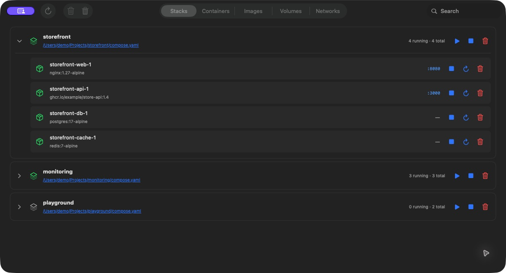
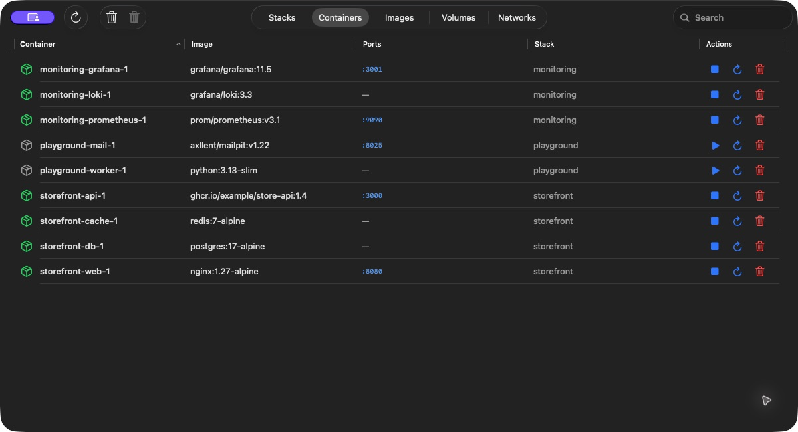
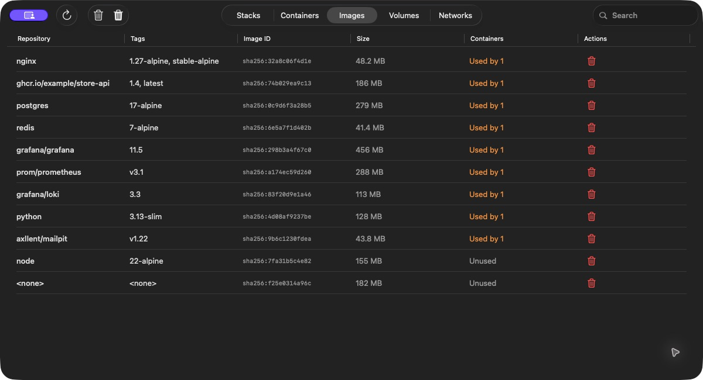
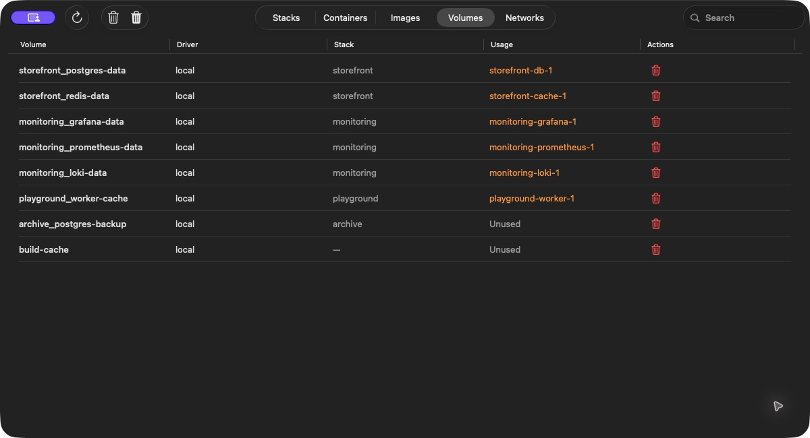
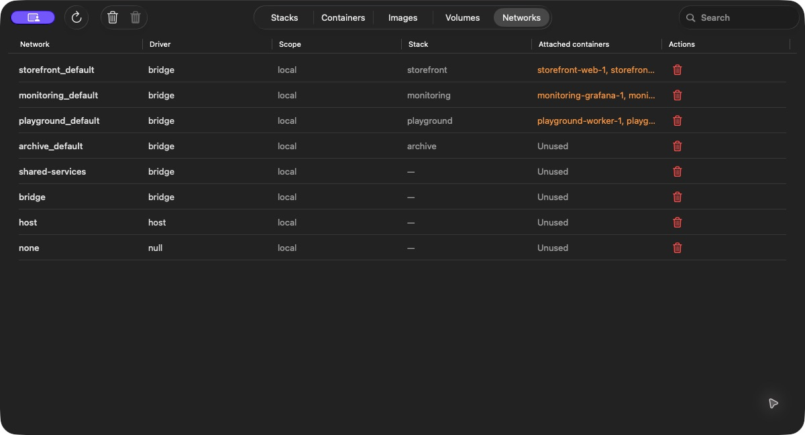

<p align="center">
  
</p>

# Colima Manager

A lightweight, native macOS app for managing Docker resources running in [Colima](https://github.com/abiosoft/colima). Built with SwiftUI, with no third-party Swift packages.

Open the app and it starts the default Colima profile when needed. Browse Compose projects, manage containers, and clean up unused resources from one window.

## Screenshots



| Containers | Images |
| --- | --- |
|  |  |

| Volumes | Networks |
| --- | --- |
|  |  |

## Features

| Tab | What you can do |
| --- | --- |
| **Stacks** | Expand Compose projects to inspect their containers; start, stop, or remove project containers. |
| **Containers** | Browse running and stopped containers; start, stop, restart, or remove them; open published HTTP ports. |
| **Images** | View repositories, tags, sizes, and container usage; remove unused images. |
| **Volumes** | Inspect ownership and container references; remove unused volumes. |
| **Networks** | Inspect drivers, scope, and attached containers; remove unused networks. |

Search the selected tab, refresh on demand, and use the toolbar to prune supported resource types. Removal and prune actions require confirmation.

## Requirements

- macOS 13 or later.
- [Colima](https://github.com/abiosoft/colima) using the **default profile with the Docker runtime**.
- [Docker CLI](https://github.com/docker/cli) and the [Docker Compose plugin](https://github.com/docker/compose).
- Xcode command-line tools with Swift 5.10 or later **only if building from source**.

Docker Desktop is not required. Colima, Docker, and Compose are installed separately from this app.

## Install

### Download the prebuilt app

1. Install the command-line dependencies described below.
2. Download **[ColimaManager-macOS-universal.zip](https://github.com/CastroM13/colima-gui/releases/latest/download/ColimaManager-macOS-universal.zip)** from the [latest release](https://github.com/CastroM13/colima-gui/releases/latest).
3. Unzip it and drag **ColimaManager.app** into **Applications**.
4. Launch it from Applications. Colima starts automatically when needed.

The ZIP supports Apple Silicon and Intel Macs running macOS 13 or later. Xcode and Swift are not needed to run the prebuilt app. Colima, Docker CLI, and Docker Compose are still required.

The prebuilt app is ad-hoc signed, without Apple Developer ID signing or notarization. If macOS blocks the first launch, and you trust the download, use **System Settings → Privacy & Security → Open Anyway** after attempting to launch it. See [Apple's instructions](https://support.apple.com/en-us/102445).

A `SHA256SUMS.txt` file is included in each release. To verify a download, put both files in the same directory and run:

```sh
shasum -a 256 -c SHA256SUMS.txt
```

### Install the command-line dependencies

With [Homebrew](https://brew.sh/):

```sh
brew install colima docker docker-compose
```

Check that Docker can find Compose:

```sh
docker compose version
```

If Compose is not found, follow the [Homebrew Compose setup instructions](https://formulae.brew.sh/formula/docker-compose). Add Homebrew's plugin directory to `cliPluginsExtraDirs` in `~/.docker/config.json`, preserving any existing settings. For a standard Apple Silicon installation, that entry is:

```json
{
  "cliPluginsExtraDirs": ["/opt/homebrew/lib/docker/cli-plugins"]
}
```

For a standard Intel Homebrew installation, use `/usr/local/lib/docker/cli-plugins`. Run `brew --prefix` to check your Homebrew prefix.

### Build from source (optional)

Install the Xcode command-line tools if needed:

```sh
xcode-select --install
```

Clone and build:

```sh
git clone https://github.com/CastroM13/colima-gui.git
cd colima-gui
./scripts/build-app.sh
```

The build creates `dist/ColimaManager.app`, including its Dock icon. No Xcode project setup is required.

### Install a local build

Drag `dist/ColimaManager.app` into **Applications** and launch it from there. You can also try the build directly:

```sh
open dist/ColimaManager.app
```

To update, quit the app and replace the copy in Applications with the latest download or a new local build. The local build script does not sign or notarize the app.

## How it works

Every Docker command explicitly targets `docker --context colima`, regardless of your globally selected Docker context. Before loading resources, the app checks the default Colima profile and starts it if stopped. Startup progress and failures appear in the window; refresh retries a failed startup.

The app loads the selected tab when opened or refreshed and reloads it after actions. It has no periodic polling loop. Closing the app leaves Colima and your containers running.

This version targets the default profile and Docker runtime. Custom profiles, other Docker contexts, and containerd are not supported.

## Removing resources

- Removing a stack removes its project containers. Compose files on disk are kept.
- Related project-owned volumes and networks are optional cleanup choices, unchecked by default. Shared resources and resources declared external in Compose are excluded. Optional cleanup is withheld if the Compose configuration cannot be checked.
- Removing a running container stops it first using Docker's configured grace period. Docker may force-terminate it if that period expires. Attached volumes are kept.
- Individual image, volume, and network removal checks container references, including stopped containers. Built-in networks cannot be removed.
- Pruning unused volumes permanently deletes their data. Review the confirmation before proceeding.

The app does not create or edit Compose files, build or pull images, or provide container logs or terminals.

## Troubleshooting

**Colima or Docker CLI not found:** install the dependencies, then reopen the app. Executable discovery checks `PATH` and common Homebrew installation paths.

**Colima fails to start:** inspect the error shown in the app and try `colima start --profile default` in Terminal for diagnostics. Once resolved, refresh the app.

**Compose operations fail:** verify `docker compose version` works and the project's recorded Compose files still exist. Stack start and stop actions use those files.

**The wrong resources appear:** verify the default profile with `colima status --profile default` and inspect `docker --context colima ps -a`. The app always uses the `colima` Docker context.

## Development

```sh
swift build
swift test
./scripts/build-app.sh
```

To build a universal distribution ZIP and its checksum:

```sh
./scripts/package-release.sh
```

This builds both `arm64` and `x86_64`, applies an ad-hoc signature, and writes `dist/ColimaManager-macOS-universal.zip` and `dist/SHA256SUMS.txt`. Developer ID signing and notarization require a separate Apple Developer setup.

Source lives in `Sources/ColimaManager`: `App` contains the window, `Views` the resource UI, `ViewModels` the presentation state, `Services` the CLI integration, and `Models` the resource types. Startup regression tests use temporary CLI fixtures without starting or stopping your real Colima instance.

Bug reports and pull requests are welcome. Include your macOS, Colima, Docker, and Compose versions, plus steps to reproduce. Remove credentials and private project details from command output before sharing it.

## Related projects

- [Colima](https://github.com/abiosoft/colima) — the container runtime environment this app manages.
- [Lima](https://github.com/lima-vm/lima) — the Linux virtual machines used by Colima.
- [Docker CLI](https://github.com/docker/cli) — the command-line interface used for resource operations.
- [Docker Compose](https://github.com/docker/compose) — the plugin used for Compose project discovery and lifecycle actions.

Colima Manager is an independent project and is not affiliated with those projects. Their software is covered by their respective licenses.

## License

[BSD Zero Clause (0BSD)](LICENSE). You may use, copy, modify, and distribute this project's code and bundled icon, including commercially, without attribution or a requirement to retain the license notice. The software is provided without warranty.
